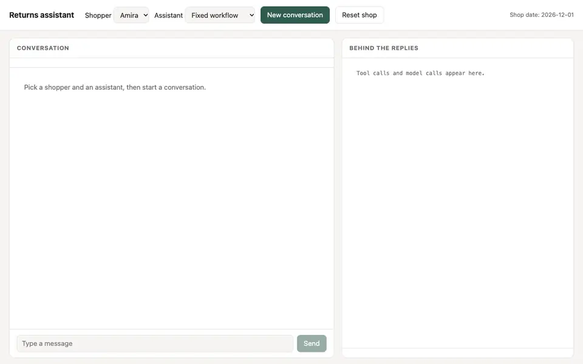

# Agent vs workflow: returns and exchanges

**Can an agent handle an ambiguous exchange better than a fixed workflow, and what does it cost?**

This project builds a returns-and-exchanges assistant for a fictional clothing shop twice:

- **An agent loop**, where the model chooses which tools to call and what to ask next.
- **A fixed workflow**, where the model makes one call to read the request and a state machine handles the rest with fixed questions.

Both versions use the same model, data, store policy and backend services. The same scenarios are run through both and graded on what ended up in the database, not on what the assistant said. If the simpler workflow wins, that counts as a result too.

> **Status: both assistants built and evaluated.** On 51 held-out conversations each, both reached the right final state about equally often (workflow 45, agent 44). The workflow was cleaner (45 vs 31 clean), about 15× faster and used about 32× fewer prompt tokens. See [RESULTS.md](RESULTS.md), [FAILURES.md](FAILURES.md) and [DECISIONS.md](DECISIONS.md). A follow-up [experiment](EXPERIMENT.md) changed one tool's result to include the next step: on 36 fresh conversations the agent's clean count rose from 10 to 17, still short of the workflow's 36/36.

[](docs/demo.mp4)

▶ **[Watch the full 7-minute narrated walkthrough](docs/demo.mp4)** (MP4, 8 MB). The preview above loops the live part, sped up. The full video covers the stack and architecture, how each assistant works, both of them running live, the safety design, the evaluation harness, results, the tool-design experiment and lessons. Narration is Kokoro TTS. Slow model waits are sped up, with the real time shown on screen.

## What the assistant does

A shopper who ordered two shirts says *"Exchange the blue one for a medium."* The assistant:

1. Finds the shopper's orders and works out which item they mean, asking one question if it's ambiguous.
2. Checks the store policy and stock.
3. Shows the exact proposal (order, item, action, new size) and waits for the shopper to confirm it.
4. Commits the action once and returns a reference. A repeated or retried confirmation returns the same reference and changes nothing else.

Requests that don't fit the policy, or that the shopper disputes, become a review case with a recorded reason, and the order is left as it was.

## Design principle: the server enforces the rules

The model interprets language and asks for tools. Server code decides everything that matters:

- who owns which order
- whether an item is eligible
- whether a confirmation matches the current proposal
- stock reservations, including two shoppers racing for the last unit
- deduplication of repeated or retried requests

So the backend guarantees are tested directly against the API and database, separately from how the agent behaves.

## How it will be evaluated

- **Scenarios with known outcomes**: hand-labelled cases covering clear exchanges, ambiguous items, mid-conversation corrections, out-of-stock replacements, policy boundaries, attempts to override policy, and requests for someone else's order.
- **Graded by final state**: each conversation is checked against the expected database and stock changes, cross-checked with the tool trace and the messages the shopper saw.
- **Checked grader**: the grader is fed known-bad cases (wrong item, silent switch of action, claimed success without a reference) and must label each one correctly.
- **Held-out set**: both systems are frozen before the held-out scenarios are run. Each scenario is run with several phrasings and repeats, and results are reported with numerators and denominators.
- **Costs and misses published**: accuracy, model calls, latency and estimated cost per system, including the cases where each one failed.

## Try it

Needs Docker, [uv](https://docs.astral.sh/uv/) and [Ollama](https://ollama.com) with `qwen3.5:4b` pulled.

```bash
make db-up && make migrate && make seed
make serve        # then open http://localhost:8000
```

Pick a shopper and an assistant, chat, and press Confirm on a proposal. The right-hand panel shows each tool call and the model calls, tokens and time behind every reply.

## Scope

The shop, shoppers and orders are synthetic. Returns and exchanges are simulated. There are no real purchases, payments, shipping, warehouse operations or identity checks.

## Roadmap

- [x] Store policy, seeded orders and the first labelled scenarios
- [x] Vertical slice: one exchange, one ambiguous request and one declined proposal, replayed end to end
- [x] Both implementations running on the same services, with backend tests and grader self-tests passing
- [ ] Testing with real people
- [x] One controlled harness experiment (change a tool design, keep model and tasks fixed)
- [ ] Hosted demo, replays, results and a short walkthrough (results published)
